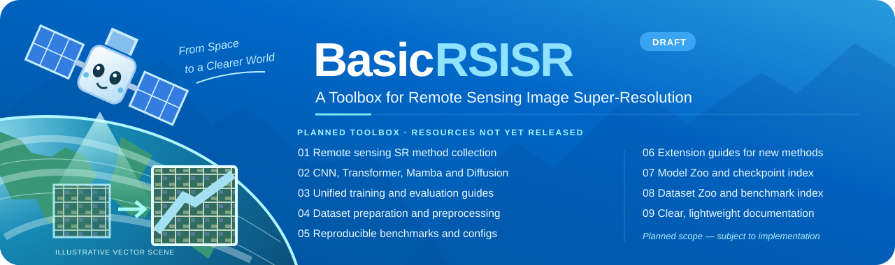

  

  <a href="#documentation">📘 Documentation</a> &nbsp; | &nbsp;
  <a href="#installation">🛠️ Installation</a> &nbsp; | &nbsp;
  <a href="#model-zoo">📦 Model Zoo</a> &nbsp; | &nbsp;
  <a href="#dataset-zoo">🗃️ Dataset Zoo</a> &nbsp; | &nbsp;
  <a href="#benchmarks">📊 Benchmarks</a> &nbsp; | &nbsp;
  <a href="#news">📰 News</a> &nbsp; | &nbsp;
  <a href="#issues">🐞 Issues</a>

English | <a href="README.zh-CN.md">简体中文</a>

> **Homepage draft — resources pending.** This is a proposed project homepage.
> Implementations, installation instructions, pretrained models, dataset entries,
> and benchmark results have not been supplied or verified.

## Overview

BasicRSISR is a proposed toolbox for remote sensing image super-resolution.
Its planned scope is to bring documentation, model information, dataset references,
and evaluation procedures into one project.

The current source repository contains only a project title and a research subtitle.
This draft establishes the homepage structure; it does not establish that the
planned software or research resources are available.

| Planned resource | Intended contents | Current status |
| --- | --- | --- |
| Documentation | Setup, data preparation, training, inference, and evaluation guides | Awaiting implementation details |
| Model Zoo | Supported architectures, configurations, and pretrained weights | No entries verified |
| Dataset Zoo | Original sources, access terms, splits, and preprocessing | No entries verified |
| Benchmarks | Reproducible settings, metrics, and comparison results | No results provided |

## Documentation

Documentation will be added once the project scope and implementation are confirmed.
The planned guides cover environment setup, data preparation, training, inference,
and evaluation.

## Installation

No validated installation procedure is available yet. Required dependencies,
supported versions, and installation commands must be derived from working code.

## Model Zoo

Model implementations and pretrained weights have not been published in this draft.
Future entries should include the original method, configuration, training data,
weight source, and applicable license.

## Dataset Zoo

Dataset entries are pending. Future entries should identify the original source,
access conditions, permitted uses, data splits, and preprocessing protocol.

## Benchmarks

No benchmark results have been provided. Future results should document the dataset,
scale factor, metric definitions, image processing rules, and runtime configuration.

## News

- **2026-10-14:** Project homepage introduced. Software resources remain under preparation; no software release has been published.

## Issues

Use the [issue tracker](https://github.com/HENU-VCG/BasicRSISR/issues) for questions,
feedback, and discussion of the planned project scope.

## Project Origin

This homepage preparation starts from [SMBUVIS/SAWMamba](https://github.com/SMBUVIS/SAWMamba).
The source README identifies the project as **SAWMamba**, with the research title
**Light Field Images Spatial Super-Resolution via Structure Awareness and Wavelet Decomposition**.

The inspected source commit is `c2b03d3fff8af31b60958da79f9acc34f61e0eb4`, whose
commit author name is `SMBUVIS`. A Git commit author name is not a verified list of
research authors. The relationship between that light-field research project and
the proposed remote sensing toolbox requires confirmation.

The original README is preserved verbatim in
[provenance/SAWMamba.README.md](provenance/SAWMamba.README.md).
See [NOTICE.md](NOTICE.md) for provenance and license status.

## License

No license file was found in the inspected source commit. This draft does not assign
a new software license. The rights holder, attribution requirements, and intended
license must be confirmed before public redistribution.
